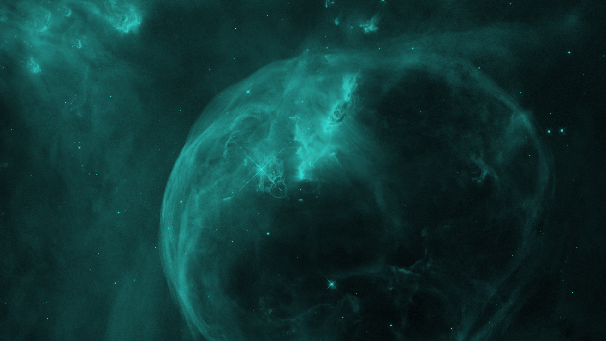

# Atomic Solution Theme for Omarchy

A precision dark cybernetic [Omarchy](https://omarchy.org) theme built from and inspired by the [Atomic Solution](https://atomic-solution.com) masterpiece portfolio and atomicOS design system.

Features deep obsidian void backgrounds (`#040708`), laser-sharp ion teal accents (`#2fd3c9`), quantum violet secondary highlights (`#878af8`), a 45° dynamic dual-stop active border gradient, and 0.93 window translucency allowing procedural 3D backgrounds to breathe through.



## Install

Requires Omarchy 4 (uses `hyprland.lua` and `shell.toml`).

```bash
git clone https://github.com/redeye1011/omarchy-atomic-solution-theme ~/.local/share/omarchy-atomic-solution-theme
ln -s ~/.local/share/omarchy-atomic-solution-theme ~/.config/omarchy/themes/atomic-solution
omarchy theme set atomic-solution
```

Optional, for GTK apps such as Files (Nautilus):

```bash
omarchy hook install theme-set ~/.local/share/omarchy-atomic-solution-theme/extras/50-gtk-css
omarchy theme set atomic-solution
```

Update with:

```bash
git -C ~/.local/share/omarchy-atomic-solution-theme pull && omarchy theme set atomic-solution
```

### Why not `omarchy theme install`?

`omarchy theme install <url>` works, but Omarchy treats a cloned theme as untrusted and drops its `*.lua` files and terminal configs, regenerating them from `colors.toml`. You would keep the palette, borders, and translucent shell, but lose custom window rules and translucent terminals. A symlink to your own clone is trusted, so every file is kept.

If you only want the palette, wallpaper, and shell:

```bash
omarchy theme install https://github.com/redeye1011/omarchy-atomic-solution-theme
```

## What's included

| File | What it does |
|---|---|
| `colors.toml` | Obsidian void palette with electric teal & quantum violet accents, plus 45° cyan-to-violet border gradient |
| `hyprland.lua` | Dual-stop active border gradient, rounding 10, soft shadow, gaps 4/6, and window opacity rules |
| `shell.toml` | Quickshell bar, launcher, menus, notifications, OSD, and tooltips at 0.93 opacity |
| `ghostty.conf`, `foot.ini` | Native terminal color schemes with 0.93 background opacity |
| `gtk.css` | GTK / libadwaita styling at 0.93 opacity (needs `extras/50-gtk-css`) |
| `icons.theme` | `Yaru-blue-dark` |
| `backgrounds/` | 6 high-resolution (3840×2160) deep-space backgrounds tuned to the Atomic Solution palette |
| `unlock.png`, `preview-unlock.png` | Atomic logo cut for boot-time disk unlock, SDDM, and Hyprlock |
| `extras/50-gtk-css` | Theme-set hook that links the current theme's `gtk.css` into `~/.config/gtk-3.0/` and `~/.config/gtk-4.0/` |

Btop, Neovim, Helix, Chromium, VS Code, Obsidian, and others are automatically generated by Omarchy from `colors.toml`.

### Translucency

Everything skinned sits at 0.93 opacity, with no blur:

- Terminals, GTK apps, and shell surfaces are translucent through their own background alpha, so text stays crisp and solid.
- Other apps get 0.93 under mouse focus and 0.84 unfocused via Hyprland window rules.
- Browsers, video apps, and games keep Omarchy's near-opaque default, because transparency can break video acceleration and WebGL canvases.

## Backgrounds

Switchable instantly via the background switcher (`Super + Ctrl + Space`) or `omarchy theme bg next`:

| File | Image Description | Source / License |
|---|---|---|
| `0-bubble-nebula.jpg` | The Bubble Nebula (NGC 7635) — Giant expanding stellar shell | NASA / ESA / Hubble (Public Domain) |
| `1-veil-nebula.jpg` | The Veil Nebula (Cygnus Loop) — Filamentary supernova shockwave | NASA / ESA / Hubble (Public Domain) |
| `2-southern-ring.jpg` | The Southern Ring Nebula (NGC 3132) — Concentric gas rings | NASA / ESA / CSA / STScI Webb NIRCam (Public Domain) |
| `3-tarantula-webb.jpg` | The Tarantula Nebula (30 Doradus) — Cosmic particle nursery | NASA / ESA / CSA / STScI Webb (Public Domain) |
| `4-helix-core.jpg` | The Helix Nebula (NGC 7293) — Cosmic ion core "Eye" | NASA / JPL-Caltech / GALEX (Public Domain) |
| `5-cygnus-loop.jpg` | Cygnus Loop Shockwave — Complex quantum filament mesh | NASA / JPL Ultraviolet (Public Domain) |

All space imagery from NASA/ESA/Hubble/Webb is in the public domain, precision-cropped to 3840×2160 (4K UHD), converted to grayscale, and gradient-mapped onto the Atomic Solution electric teal (`#2fd3c9`) and quantum violet (`#878af8`) color spectrum.

## Credits & License

- Configuration files and scripts: [MIT](LICENSE).
- NASA / ESA / Hubble / Webb imagery: Public Domain under NASA and STScI guidelines.
